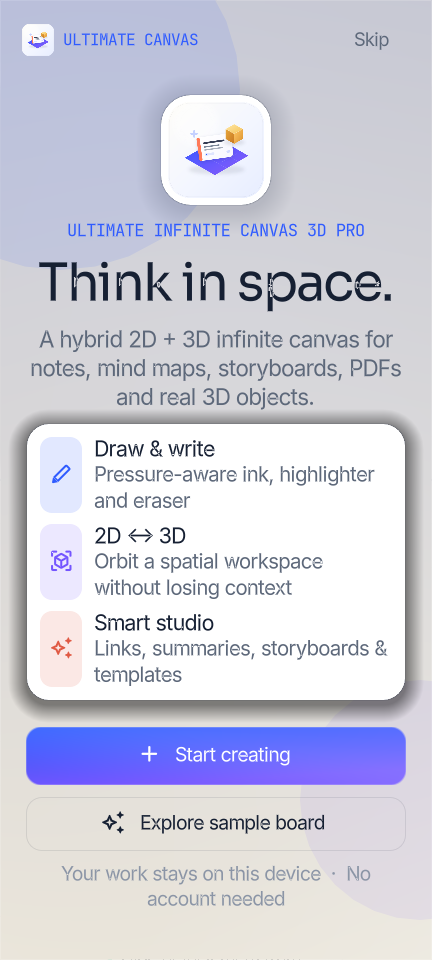
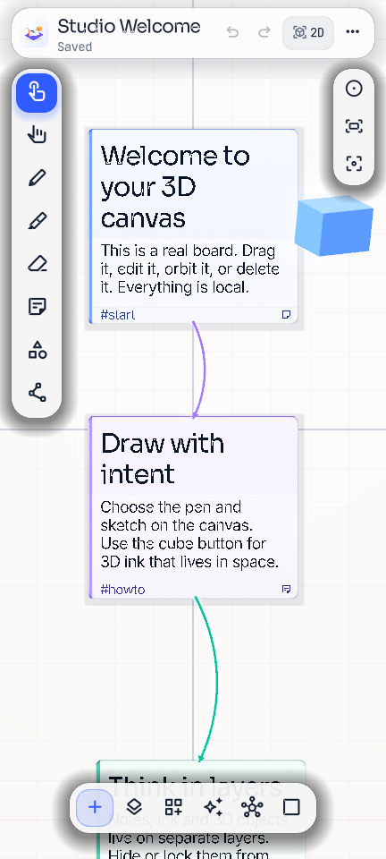
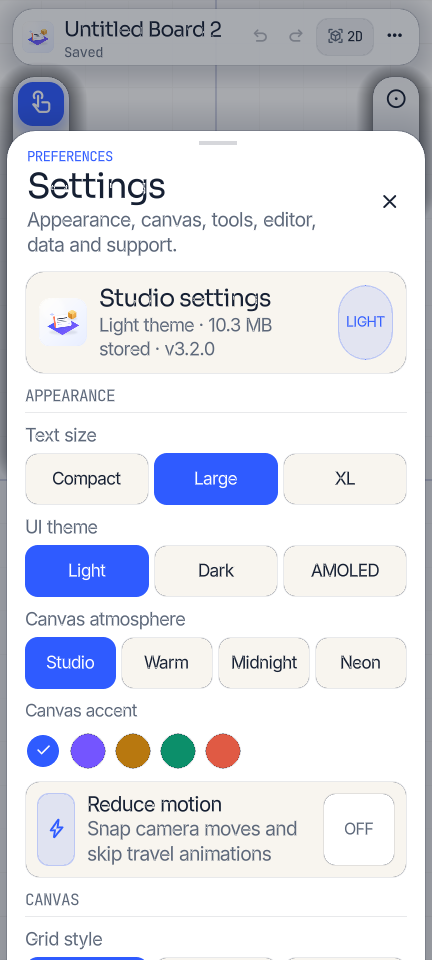
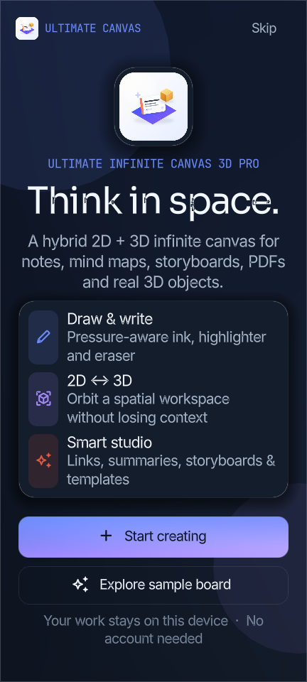
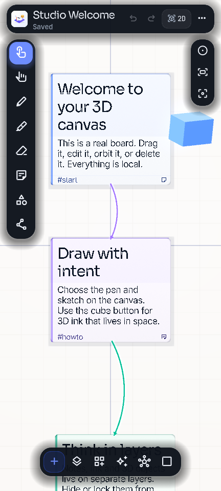
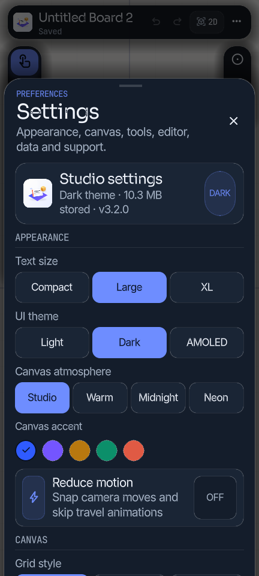
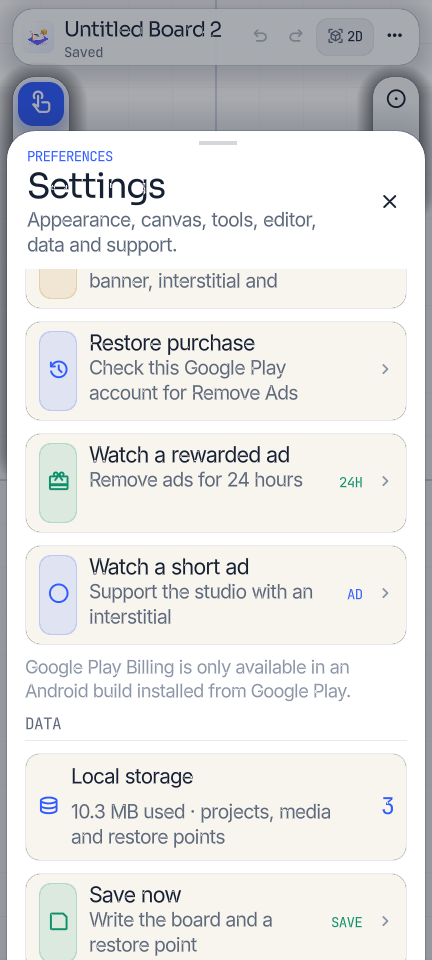
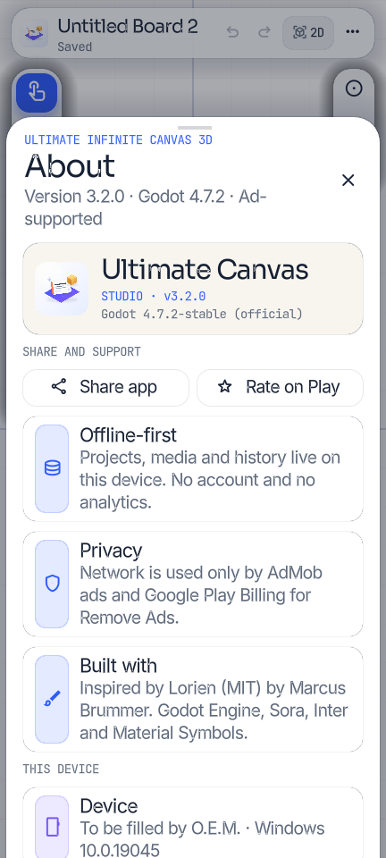

# Ultimate Infinite Canvas 3D Pro

**Version 3.2.0** · A premium **2D + 3D infinite whiteboard** for Android with **Light / Dark / AMOLED** themes, built with **Godot 4.7.2** and inspired by [Lorien](https://github.com/mbrlabs/Lorien) (MIT).

One spatial surface for notes, freehand ink, mind maps, storyboards, PDFs, images and real 3D objects. Switch between a crisp 2D canvas and a perspective 3D workspace without losing context.

> **3.2.0 — Themes, ads and a cleaner studio.**
> Dark and AMOLED themes, a full typography/layout audit across every detail page, real AdMob banner/interstitial/rewarded ads, and **Remove Ads ($4.99 one-time)** replacing the old Pro subscription. Every previous Pro feature is now free and unlocked.

---

## What is real in this build

| Area | Implementation |
|---|---|
| Themes | **Light porcelain (default), Dark, AMOLED**; the UI rebuilds live from a theme token system; selection persists |
| Typography | Enlarged onboarding/chrome/rows/cards; minimum type floor + Compact/Large/XL scale; text-wrapped rows, taller cards and clamped graph labels to stop clipped copy |
| Infinite canvas | Unbounded coordinates, GPU grid with line/dot/off styles, logarithmic zoom |
| Camera | Six-direction navigation, presets, bookmarks, reduced-motion option |
| 2D ↔ 3D | One scene, animated or instant camera morph |
| Drawing | Pressure-aware 3D ribbon strokes, highlighter, eraser; pressure can be disabled |
| Notes, media, PDF | Live notes, images, Android `PdfRenderer` pages, GLB/glTF imports, PBR primitives and materials |
| Story / structure | Storyboard frames + playback, Smart Studio, knowledge graph, templates, layers, hierarchy, connectors, undo/autosave/restore points |
| Settings | **Theme, text scale, atmosphere, accent, grid/snap, tools, editor, ads/Remove Ads, data, support** – all wired |
| Ads | Real **Google Mobile Ads** SDK: anchored adaptive **banner**, preloaded **interstitial**, and **rewarded ad that removes ads for 24 hours** |
| Remove Ads | Real Google Play Billing one-time product **`remove_ads`** (set it to **$4.99** in Play Console). Permanent entitlement; banner/interstitial/rewarded hidden after purchase |
| About / Share / Rate | Device facts, licence, native Android share sheet via `ShareBridge`, Play Store rating intent |
| No Pro mode | Pro gates/subscriptions/free-board limits removed; every template/atmosphere/accent is available |
| Offline-first | Boards stay on device; network is used only by AdMob and Play Billing |

> **Ads use Google’s official AdMob TEST app/ad-unit IDs out of the box.** The SDK and ad format code are real, but you must replace the test IDs with your own AdMob IDs before publishing (see [`docs/ADS_SETUP.md`](docs/ADS_SETUP.md)). Test ads do not earn revenue.

### 3.2.0 build status

- **Automated tests:** 92 passed, 0 failed.
- **Desktop visual QA:** Light and Dark/AMOLED onboarding, canvas, empty state, Settings, About and all detail sheets at 432×960; text clipping audit fixed Export, Templates, Projects, Layers, Graph labels, Help title, Primitive, Inspector, Settings and onboarding.
- **AdMob:** Gradle compiles the real Google Mobile Ads SDK and `AdBridge`; the SDK initialized successfully during Android emulator testing. Banner/interstitial/rewarded display could not be visually re-confirmed because the emulator and phone both dropped offline before the final UI smoke test.
- **Physical phone:** v3.1.0 remains installed (splash, light board, Settings, XL rebuild, native share sheet and rate chooser verified earlier). The v3.2.0 APK/AAB are signed and ready. MIUI blocked the last ADB update with `INSTALL_FAILED_USER_RESTRICTED`; install the APK manually or enable Developer options → Install via USB.
- **Billing:** Remove Ads purchase requires the APK from a Play track and the `remove_ads` product configured at $4.99. Sideloaded builds correctly report Billing unavailable and never fake a purchase.

---

## Screens

| | |
|---|---|
|  |  |
|  |  |
|  |  |
|  |  |

Additional light/dark captures live in `docs/screenshots/`.

---

## Build & artifacts

### Debug APK with ads + Billing

```bash
godot --headless --path . --export-debug "Android Gradle APK" build/UltimateInfiniteCanvas3D-gradle.apk
```

### Signed release artifacts — v3.2.0, versionCode 5

- `build/UltimateInfiniteCanvas3D-v3.2.0-release-signed.apk` — arm64, v2 + v3 signatures, 16 KB aligned.
- `build/UltimateInfiniteCanvas3D-v3.2.0-release.aab` — signed Play upload bundle.
- `build/ultimatecanvas-release.keystore` — alias `ultimatecanvas`; **back it up**.
- `build/UltimateInfiniteCanvas3D-v3.2.0-source.zip` — full source, Android bridge, tests and docs.
- A packaged copy is in the Desktop delivery folder.

The APK/AAB include the arm64 Godot runtime, Google Mobile Ads, Play Billing, the native PDF bridge and the Share bridge. `minSdk 24`, `targetSdk 36`.

Sign the AAB with the release keystore:

```bash
jarsigner -sigalg SHA256withRSA -digestalg SHA-256 \
  -keystore build/ultimatecanvas-release.keystore \
  build/UltimateInfiniteCanvas3D-v3.2.0-release.aab ultimatecanvas
```

Keystore: `build/ultimatecanvas-release.keystore` · alias `ultimatecanvas` · **the password is kept offline** (see `build/SIGNING-KEY.txt` in your local, uncommitted build folder). Never commit the keystore or its password — both are excluded by `.gitignore`.

---

## Testing

```bash
godot --headless --path . --script res://tests/test_runner.gd
```

**92 passed, 0 failed.** The suite covers the project model, undo, Smart Engine, storage, backups, exports and PDF guards. Desktop QA, the Android ad verification status and the physical-device checklist are in [`docs/TESTING.md`](docs/TESTING.md).

---

## Monetisation setup

1. Create **`remove_ads`** as a one-time in-app product in Play Console, priced at **$4.99** (or your local equivalent).
2. Upload the signed AAB to a Play track and install from Play; Billing is not usable in a sideloaded APK.
3. Create an AdMob app + banner/interstitial/rewarded units and replace the test IDs in:
   - `android/build/src/main/AndroidManifest.xml` (AdMob application ID)
   - `android/build/src/main/java/com/godot/game/AdBridge.java` (three ad-unit constants)
4. Follow [`docs/ADS_SETUP.md`](docs/ADS_SETUP.md) and [`docs/PLAY_CONSOLE_SETUP.md`](docs/PLAY_CONSOLE_SETUP.md).

The rewarded ad grants a real 24-hour ad-free window. Remove Ads is permanent. No Pro products/subscriptions remain.

---

## Data & privacy

Projects, media, PDFs, autosaves and exports remain in the app’s private storage. AdMob/Google and Google Play process ad delivery and purchases under their own policies. The app itself has no account, analytics, cloud sync or ad-targeting profile. Full text: [`docs/PRIVACY_POLICY.md`](docs/PRIVACY_POLICY.md).

---

## Project layout

```
scripts/
  app.gd                     orchestrator, ads/theme/remove-ads wiring, input, files
  ads_service.gd             AdMob bridge lifecycle, banner reserve, reward polling
  billing.gd                 Play Billing remove_ads purchase/entitlement
  ui/
    ui.gd                    chrome, sheets, onboarding, splash, ad overlay rules
    panels.gd                create, templates, layers, smart, graph, storyboard,
                             projects, export, inspector, nav, look, help, about
    settings_panel.gd        complete Settings + Ads/Remove Ads + restore points
    kit.gd                   Light/Dark/AMOLED theme tokens and components
  core/                      project, undo, storage, smart engine, PDF bridge
  world/                     camera, grid, notes/frames/media/models/ink/connectors
android/build/               Godot Gradle template + AdMob/PDF/Share Java bridges
addons/GodotGooglePlayBilling/ Play Billing plugin
tests/test_runner.gd         92 headless tests
docs/                        ADS_SETUP, TESTING, PLAY_CONSOLE_SETUP, STORE_LISTING, PRIVACY_POLICY
assets/                      icon, splash, fonts, shaders, icon subset
```

---

## Attribution

Inspired by [Lorien](https://github.com/mbrlabs/Lorien) by Marcus Brummer (MIT). Built with [Godot Engine](https://godotengine.org) (MIT). Fonts: Sora, Inter, JetBrains Mono (SIL OFL). Icons: Material Symbols Rounded (Apache 2.0). See `THIRD_PARTY_NOTICES.md` and the in-app About screen.

This project is an independent implementation. It does not copy Lorien's source code.
